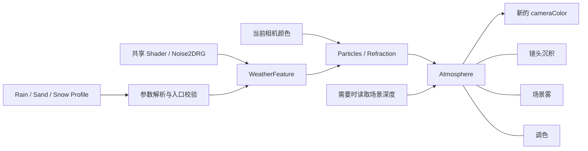

# Weather 管线整合设计

日期：2026-10-08。状态：已按用户授权实施。下方原始审计快照保留历史状态；最新入口为 PC Renderer 中的 WeatherFeature，默认 Sand。

用户已确认首版采用单一天气预设，内部模块独立调节和关闭。[需求](requirements.md)与[实施任务](tasks.md)共同约束本设计。路径均以仓库根目录为基准；行号对应当前工作副本。

最新范围：Weather仅包含模块化Particles与Atmosphere；Rainy的blur在整合时直接抛弃，雨滴折射保留。Atmosphere含镜头沉积、场景雾和调色，可分别控制。原Rainy含blur版本留作历史对照，Weather的Rain目标基线按去掉blur定义。

## 1. 检查结论

建议整合为一个WeatherFeature、一个Weather Shader、三份迁移预设。共享资源、随机数、周期／网格工具、闭式复合、雨沙高度雾与调色骨架；雨滴折射、沙粒叠色、雪霜边和雪的旧深度雾保留模式差异。Rain氛围不迁移RainyBlur、五点滤波或相关参数。

模块化以算法职责和参数控制为边界。绘制维持两阶段：粒子／折射 → 气氛；镜头沉积、场景雾、调色在气氛阶段内按原顺序执行。首版不建立通用插件注册器，也不为每个模块分配独立 RT。

### 原始审计快照：资产与参数

| 检查项 | Rainy | Sandy | Snowy |
|---|---|---|---|
| Shader | PostProcess/Rainy | PostProcess/Sandy | PostProcess/Snowy |
| 当前入口 | DebugOutputFeature | DebugOutputFeature | DebugOutputFeature |
| 粒子阶段 | 4×4 网格雨滴高度差分折射 | 40×24 网格沙粒赭色混合 | 全屏单个周期落点，雪斑向白混合 |
| 气氛阶段 | 边缘水汽＋五点模糊＋高度雾＋冷调色 | 边缘积尘＋高度雾＋暖调色 | 两层噪声霜边＋滚动深度雾＋冷调色 |
| Noise2DRG 通道 | R：高度、水汽；G：场景雾 | R：沙粒、积尘；G：场景雾 | R：雪斑、霜边、滚动雾 |
| 材质 Randomness | 1 | 1 | 1 |
| 材质 Wind | 0.5 | 0.5 | 0.5 |
| 材质温度强度 | Coldness=1 | Warmth=1 | Coldness=1 |
| 材质复合强度 | Foggy=0.5 | Dusty=1 | Frost=0.3 |
| Alpha | 保留输入 | 保留输入 | P0 保留；P1 改变 |
| 雾相机支持 | 透视与正交重建 | 透视与正交重建 | 旧 LinearEyeDepth 路径，未实现正确正交解算 |

此表记录原始实现，其中Rain的五点模糊是旧行为；目标Weather已明确移除它。三者Shader默认值均为Randomness=0.5、Wind=0.5、温度强度=0.3、复合强度=0.5。迁移预设从实际材质值生成，不能套用这一组默认值。

证据：三套 `Assets/Mine/Shaders/PostProcess/<名称>/<名称>.shader:8`、`Mine_PostProcess_<名称>.mat:26`。具体算法见 Rainy.shader:66、140；Sandy.shader:42、79；Snowy.shader:42、95。

### 共享资源契约

三份材质均绑定 `Assets/Textures/Noise2DRG.asset`，GUID=`acde34ba16b7a4de1ad501e1068301d9`、fileID=2800000。每份材质都是 1 texture＋4 floats，没有未声明残留属性。

Noise2DRG 当前为 512×512、RGBA32、1 mip、Bilinear、Repeat、Readable，RG 是不同噪声通道，B=0、A=255。资源没有记录种子、频率或生成配方，不能按名称重新烘焙替代。其 GUID 也被 Water 材质和两个 Recovery 场景引用，保留在 `Assets/Textures/`，不搬入 Weather。

当前资源是 sRGB（`Noise2DRG.asset:40` 的 m_ColorSpace=1），项目为 Linear（`ProjectSettings/ProjectSettings.asset:50`）。第一阶段保留像素、格式、颜色空间和采样器；改为线性噪声应另做视觉变更。Unity 的枚举／构造语义依据官方 [GraphicsEnums.cs](https://github.com/Unity-Technologies/UnityCsReference/blob/master/Runtime/Export/Graphics/GraphicsEnums.cs) 和 [Texture.cs](https://github.com/Unity-Technologies/UnityCsReference/blob/master/Runtime/Export/Graphics/Texture.cs)。

`Assets/Textures/Noise2D.asset` 不属于此次天气输入，不清理。NoiseGeneratorWindow.cs:601 的覆盖保存路径使用 DeleteAsset→CreateAsset，可能丢 GUID；本次不调用该路径，也不扩大为生成器重构。

### 原始接入状态

初始磁盘审计快照的 `Assets/Settings/PC_Renderer.asset:65` 中 DebugOutputFeature 的 Active=0；材质／Shader 指向 Sandy，AdditionalPassIndex=1、RequireDepth=true、Debug=true（67–71）。因此该快照没有运行任何一套天气；本次没有读取 Editor 内存态，不能推断当前 Game View。规划期间存在其它会话并行改动，最终复核中该天气绑定未变，但Renderer的其它Feature清单已有变化；实施前重新记录完整配置，不能将快照作为可直接覆盖的恢复文件。

当前为 PC Quality、PC_RPAsset、PC_Renderer；RenderGraph 有效配置为 `UniversalRenderPipelineGlobalSettings.asset:355` 的 compatibilityMode=0。旧 m_EnableRenderGraph 字段不是当前开关。环境版本：Unity 6000.3.14f1、URP 17.3.0。

DebugOutputFeature 的事件为 AfterRenderingPostProcessing，数据流为：

```text
activeColor → 天气 Pass 0 → _DebugShaderOutputRT
                              → 天气 Pass 1 → 原 activeColor
                              → 或普通 copy（未配置 Pass 1）
```

合法双 Pass 的天气成本是 2 次全屏着色、0 次纯复制；仅 P0 时是 1 次着色＋1 次复制。URP final resolve/blit 属于后续管线，另计。证据：DebugOutputFeature.cs:62、89、112、139。

## 2. 推荐结构



建议最终落点：

```text
Assets/Mine/Scripts/Weather/
  WeatherFeature.cs                 Feature、两个 RenderPass、资源／相机设置
  WeatherProfile.cs                 Profile 数据、默认预设、范围校验

Assets/Mine/Shaders/PostProcess/Weather/
  Weather.shader                    PostProcess/Weather，两个命名 Pass
  WeatherCommon.hlsl                随机数、周期网格、Composite10、上下文工具
  WeatherParticles.hlsl             Rain / Sand / Snow 粒子模式
  WeatherAtmosphere.hlsl            镜头、雾、调色函数与按模式合成
  Presets/Rain.asset
  Presets/Sand.asset
  Presets/Snow.asset
  README.md                         最终功能说明、参数、限制和迁移记录
```

Feature 位于 Scripts/Weather，遵守 `.agents/rules/csharp-renderpass.md` 的硬规则；Shader 与家族 HLSL 位于 PostProcess/Weather。三份 HLSL 是 Weather 家族内部共享，先不加入 Special/HLSL；调用依赖由 Weather.shader 统一声明，函数使用 Weather_ 前缀，避免重复定义。旧三个目录在验收前保留，正式清理需另列精确清单。

这是一份文件布局建议，本轮没有创建以上 Assets 文件，也没有移动旧资产。

## 3. 数据所有权与接口

| 组件 | 负责的内容 | 所有权／限制 |
|---|---|---|
| WeatherFeature.Settings | Weather Shader、Noise2DRG 引用、选择的 Profile、相机策略、事件与 Debug | 仅持有管线资源和技术配置；不重复保存美术参数 |
| WeatherProfile | Kind、公共随机／周期参数、Particles / Lens / Fog / Tone 参数、迁移 Alpha 策略 | 美术参数唯一来源；首版使用普通 ScriptableObject，不再增加 Volume 或控制器 |
| ResolvedWeatherSettings | 校验后的值、模块 active mask、模式选择 | 每次录图从 Profile 生成不可变快照；不把运行时钳制结果写回资产 |
| WeatherScreenContext | sourceUV、等比 effectUV、实际源 RT texelSize、时间、必要的相机／深度数据 | 屏幕取样坐标与效果坐标明确区分；只求活动模块所需数据 |
| Particle 阶段 | 折射或者叠色 | Rain/Sand/Snow 模式有明确分支；没有跨天气循环 |
| Atmosphere 阶段 | 镜头遮罩／染色、雾项、调色、最终合成 | 独立模块函数；Rain移除blur，其余按原合成顺序编排 |

概念接口（并非已实现 API）：

```text
Resolve(profile) → immutable settings + activeModules
Weather_ApplyParticles(context, source, particleSettings, kind) → color
Weather_EvaluateLens(context, lensSettings, kind) → lens terms
Weather_EvaluateFog(context, depth, fogSettings, model) → fog terms
Weather_ComposeAtmosphere(source, lens terms, fog terms, kind) → color
Weather_ApplyTone(color, toneSettings) → color
```

模式仅 Rain / Sand / Snow 三选一。采用一组互斥 multi_compile_local keyword 保留三个模式变体，避免仅靠ScriptableObject预设时shader_feature变体被构建剥离。首版不为四个模块制造 2⁴ 组合变体，统一参数分支和 C# 阶段跳过足以控制成本。

所有开关型参数遵循“0=关闭”；不同时暴露 enabled 与 strength。空间形状／宽度与强度分别控制，强度关闭优先于形状计算。Performance 首版仅保留原预算，不新增未经测量的质量档。

## 4. 参数统一与迁移

### 公共与模块参数

| 分组 | 字段语义 | 迁移约定 |
|---|---|---|
| Common | Randomness、ParticleCycleRate | Randomness 从原值复制，保留各模式 seed 分量／系数；CycleRate 为每秒周期速率，从旧 `_Time.y * Wind * 2` 映射为 `2*Wind`；0 冻结 |
| Particles | ShapeThreshold、Opacity、Rain RefractionScale | ShapeThreshold是SDF阈值，不是TRS尺寸；shape与opacity初值分别复制旧Foggy/Frost，Sand只迁移opacity；RefractionScale为内部0.015的乘数，初值1，不复制Foggy |
| Lens | Mist/Deposit/EdgeOpacity、EdgeWidth | 雨沙镜头强度分别复制Foggy/Dusty；雪将霜边宽度与透明度分开；Rain只保留水汽遮罩与染色，没有blur字段 |
| Fog | Model、Strength/Opacity、HeightFalloff 或 BaseDistance/NoiseDistance、NoiseScroll | 雨沙采用 HeightMidpoint；雪保留 LegacyEyeDepth；滚动、雾距离不再跟 ParticleCycleRate 隐式联动 |
| Tone | Strength、Tint | Coldness/Warmth 映射为 Strength；冷／暖色倍率由预设给出 |
| Technical | AlphaPolicy、相机策略、正最小雾距离 | AlphaPolicy=PreserveInput 或 LegacySnow，只用于明确兼容；几何／合法范围与美术强度分组 |
| Debug | Off / Particles / Refraction / Lens / Fog / Final | 使用同一管线的数据／函数，不改 Profile 美术值 |

字段只是目标语义，实施前需逐一固定类型、范围和 PropertyToID→CBUFFER 映射。不能把 `_Foggy/_Dusty/_Frost` 直接改名为单一 WeatherIntensity：雨雪用它控制 SDF 形状及 opacity，雨还用于折射高度与梯度；沙粒 opacity 则主要是线性响应。

### 迁移映射与合成顺序

Rain：令F为旧Foggy。Particles的shapeThreshold/opacity初值均为F，RefractionScale=1；LensMistStrength=F，SceneFogStrength=F。Opacity继续进入高度函数的Composite10之前，不能只乘最终offset，否则梯度响应不兼容。保留镜头tint系数0.12、场景雾系数0.65；删除blur调用、混合系数0.8、半径2–5px和五点核。氛围直接从粒子阶段输入场景色进行染色：

```text
mist = edgeMask * lerp(0.75, 1, noise.r) * lensStrength
fog = heightFogBase * fogStrength * 0.65
tintWeight = 1 - (1-fog)*(1-mist*0.12)
result = Tone(lerp(scene, rainFogColor, tintWeight))
```

镜头模块关闭时mist=0；场景雾关闭时fog=0、不采深度。水汽保留边缘罩色，模糊带来的柔化已明确取消。雨滴差分仍保留边界判断与采样顺序，不能因“公共缓存”改变网格边界处的输入。Rain验收参照仅取消blur的目标结果，不能要求最终画面等价于含blur旧版。

Sand：令 D 为旧 Dusty。ParticleOpacity=D、LensDepositStrength=D、SceneFogStrength=D；保留 fog 系数 0.75、deposit 系数 0.55，顺序必须为：

```text
scene → lerp(warmFogColor, fog) → lerp(darkDepositColor, deposit*0.55) → warmTone
```

镜头与雾颜色不同，不能套用 Rain 的一次相同 tint 合并。当前 coverage 没接入输出，兼容阶段也不接入。

Snow：令 F 为旧 Frost，W 为旧 Wind。保留 `edge → fog → coldTone`，并按下表拆开控制：

| 字段 | 旧→新映射 | 当前材质 F=0.3、W=0.5 |
|---|---:|---:|
| ParticleShapeThreshold / ParticleOpacity | F / F | 0.3 / 0.3 |
| EdgeBaseWidth | 0.1F | 0.03 |
| EdgeNoiseWidth | F | 0.3 |
| EdgeOpacity | F | 0.3 |
| FogBaseDistance | 100(1-W) | 50 |
| FogNoiseDistance | 100 | 100 |
| FogOpacity | F | 0.3 |
| FogNoiseScrollX | W | 0.5 |
| ParticleCycleRate | 2W | 1 |
| ToneStrength | Coldness | 1 |

拆出的 fogDistance 与原 `100*(1+nScroll-W)` 数学等价，但浮点求值顺序可能不同。纯抽取阶段优先保留原求值顺序；参数解耦阶段用预先确定的误差容限验收，不能宣称自动逐位一致。

Snow 兼容 Alpha 继续为 `1-(1-a)*(1-edgeWeight)*(1-fogWeight)`。统一保留输入 Alpha、统一高度雾和正确正交支持分别作为后续行为变更，不能混入“等价抽取”。

### 集中范围处理

Profile的编辑校验与Resolve的运行校验共用一套规则，覆盖脚本赋值。模块强度为0时先排除运算。Rain粒子仅在ShapeThreshold>0、Opacity>0且RefractionScale>0时活动，任一为0直接返回零offset，正常Debug=Off路径可跳过P0；Snow粒子要求ShapeThreshold与Opacity均正，Sand粒子要求Opacity为正。

Snow霜边按最终像素宽度定义零宽度，而非仅检查Profile两个字段：`width=EdgeBaseWidth+EdgeNoiseWidth*n7*n5`，`width<=0`时mask=0，否则计算`1-smoothstep(0,width,edge)`。这是噪声参与后派生宽度的数学分支，不是到处添加epsilon；入口保证两个宽度字段非负。FogBaseDistance在入口保证严格为正、FogNoiseDistance非负，使整个[0,1]噪声域内距离为正；最低距离按世界尺度明确指定，不靠将Wind强制小于1维持分母。缺资源／相机状态属于资源检查，与参数范围保护分开。

## 5. RenderGraph 调度

首次接入保持 AfterRenderingPostProcessing，保留原后处理色调映射上下文；以后是否把世界雾前移单独评估。相机色包含透明物体，Depth 主要来自不透明 prepass，二者遮挡范围不同。

```text
Particles 活动，Atmosphere 活动：source → P0 → particleColor → P1 → finalColor
仅 Particles 活动：             source → P0 → finalColor
仅 Atmosphere 活动：            source → P1 → finalColor
全部关闭且 Debug=Off：          不 enqueue，不建天气 RT，不请求天气输入
```

每个绘制有独立PassData、明确Read输入／Write attachment；不同时读写同一颜色目标。对首版支持的resolveFinalTarget=true Base Camera，末端设置`resources.cameraColor=finalColor`供同一相机图后续URP final pass使用，省去固定写回copy。目标描述从实际source TextureDesc派生，保留格式、尺寸、slices和动态分辨率；实际RT texelSize决定UV等比空间。去掉blur无需增加滤波Pass，也不改变最多两阶段调度。

Debug单独参与有效模块与阶段解析：Particles／Refraction 只运行粒子阶段且不请求Depth；Lens只运行氛围且不请求Depth；Fog只运行氛围并请求Depth；Off／Final按活动模块运行，FogStrength>0时请求Depth。Fog Debug通过同一雾函数评估基础雾项，不回写Profile；即使最终雾强度为0也需Depth。无效或关闭的形状返回定义的零贡献。诊断绘制及输入成本单独记录，不纳入Debug=Off的零增量承诺。

仓库参考：`Assets/Mine/Shaders/PostProcess/SSGI/SSGIFeature.cs:131`、143、180。本机 URP 官方 `UniversalRendererRenderGraph.cs:1506`、1531 在 final pass 前重新读取 cameraColor，支持注入 Pass 替换颜色。

这一输出替换不能自动跨Camera Stack传播：URP每相机独立录制／执行RenderGraph，非末端Base不执行final pass，下一Overlay从持久相机颜色导入，并不会接上本相机新增的transient finalColor。首版在入队前排除resolveFinalTarget=false Base并一次诊断，Overlay也不执行天气。未来支持Stack需要明确最后相机调度或写回持久目标，再决定额外复制与透明UI顺序，不复用此处的无条件零copy假设。证据：本地UniversalRenderPipelineRenderGraph.cs:22、UniversalRendererRenderGraph.cs:1519、1857。

ConfigureInput(Color)指不透明颜色复制，不是activeColor的别名；不要因为要采当前颜色就照搬Color|Depth|Normal|Motion。仅在fogRequired时请求Depth，以requiresIntermediateTexture支持可采样颜色；全关闭且Debug=Off时在AddRenderPasses跳过，避免入队已让URP创建中间颜色。背景管线自身已请求的depth/opaque成本仍存在，“零成本”仅指Weather增量。

Shader 静态噪声使用普通 Texture2D 与普通采样；相机颜色／深度遵循 URP 的 `_X` 宏。当前规范对“所有后处理纹理用 `_X`”的表述过宽，需要在实施门禁前说明静态资源与相机 RT 的区别，不能让普通 Noise2DRG 在 XR 下被当成数组。首次不承诺 XR 已通过，后续按实际目标设备补验。

### 生命周期与相机

- Feature 创建自持运行材质；不 SetFloat/SetTexture 到原三份 `.mat`，不对 Profile 调用 SaveAssets。
- PassData 捕获已解析参数；在执行回调绑定，或用等价的独立材质／MPB。不能在录图时连续更改共用材质后让延迟 Pass 全读到最后一次参数。
- 检查 shader.isSupported、命名 Pass 与资源；无效 Shader/Profile/噪声/相机色时跳过并一次诊断。缺深度时明确跳过雾并保留可执行模块，避免输出半套天气却无说明。
- 默认作用于选定 Renderer 的Game Base Camera，且要求resolveFinalTarget=true；排除非末端Stack Base、Overlay、Preview、Reflection。SceneView提供显式策略。小地图／离屏Game Camera须通过Renderer分配或明确allow-list排除，不以cameraType=Game作为“主相机”的证明。
- 首版不增加 per-camera Profile 系统；验收多个独立Base Camera的实际尺寸与参数，以及不支持的Stack路径确实跳过并诊断。禁用／Dispose／domain reload／Shader 更换正确释放与重建自持材质。

## 6. 固定预算与风险登记

| 模块 | 兼容预算 | 首版策略 |
|---|---|---|
| Rain 粒子 | 最大 5 次噪声、2 次场景色采样，既有早退 | 保留差分步长0.02／除数0.04、网格4×4、折射0.015；先抽取后测量 |
| Sand 粒子 | 1 噪声＋1 场景色采样，40×24 | 保留单层，不新增 Composite10 |
| Snow 粒子 | 1 噪声＋1 场景色采样、单落点 | 保留 Composite10 的乘法链，不误建十粒子循环 |
| Rain 气氛 | 1场景色＋1 RG噪声；需要雾时1 depth | 直接水汽／雾染色后调色；原五点blur采样调用全部移除，GPU收益实际测量 |
| Sand 气氛 | 1 RG 噪声＋1 depth | 保留 fog→deposit→tone |
| Snow 气氛 | 3 噪声＋1 depth | 保留7x、5x霜边及滚动雾；不因资源合一错误复用不同UV取样 |

| 风险／差异 | 当前证据 | 处理与阶段 |
|---|---|---|
| 参数响应耦合、非线性 | Rainy.shader:58、Snowy.shader:59、Sandy.shader:59 | 分字段迁移；正常值先对照，阶段3解耦 |
| Rain去掉blur的有意视觉变化 | 用户明确要求抛弃；原Rainy.shader:126的五点核 | 保留原版对照；建立仅去blur目标基线，其余逻辑对照验收 |
| Sandy coverage 未使用 | Sandy.shader:71–73；README:9 | 不接线以保基线；未来视觉修复另立项 |
| Sandy 文档值错误 | README:27 vs mat:32–35 | 以材质为准；实施文档收尾修正 |
| Snow alpha 改写 | Snowy.shader:106、111 | 兼容策略显式保留；统一 Alpha 另验收 |
| Snow 退化宽度／雾分母 | Snowy.shader:105、110 | 阶段3集中端点处理，并验0/1 |
| Rain 折射等比坡度直接用于 UV | Rainy.shader:103–104 | 保留旧响应；长宽比修正单独验收 |
| 静态噪声／相机纹理宏混用 | Snowy.shader:21、84、100 | 规范澄清后统一声明和采样；不声称已验证 XR |
| 透明深度限制 | PC_Renderer.asset:157 ForcePrepass | 保留并文档化；移事件不自动解决 |
| Camera Stack跨图输出 | URP每相机独立RenderGraph；transient输出不传入下一Overlay | 首版仅final-resolving Base；其余入队前跳过，支持Stack另立项 |
| Sandy meta mainObjectFileID=0 | Mine_PostProcess_Sandy.mat.meta:5 | AssetDatabase 只读加载核验；不据此手工重建 GUID |
| 当前 dirty/untracked | Rainy 三文件、PC_Renderer dirty；Sandy untracked | 保留工作副本；新管线增量接入，不回退到 HEAD 覆盖 |

### P2b：规范符合度与目标处理

| 规范项 | 当前状态 | Weather 计划 |
|---|---|---|
| 文件头、UnityPerMaterial、HLSLINCLUDE 分离 | 三 Shader符合 | 保留结构；公共字段有一个明确声明位置 |
| Core→Blit→Depth→TRS include | 三 Shader符合 | 延续依赖前置，工具函数先定义再调用 |
| Shader 两段菜单路径、命名 Pass、内置 Vert、target2.0 | 三 Shader符合 | PostProcess/Weather、Particles／Atmosphere；target按实际功能验证 |
| URP Tag、Cull Off／ZWrite Off／ZTest Always | 三 Shader符合 | 保留统一状态 |
| 复杂计算拆分为独立函数 | 气氛 Frag 仍混合多职责 | 拆镜头、雾、调色及模式编排函数 |
| Shader 不放公式推导 | Snowy:65–66 不符合 | 新代码只写职责注释，推导放 README |
| 相机纹理采样一致 | Snow P0 不符合 `_X` 契约 | 统一 URP 相机纹理路径 |
| 静态噪声契约 | 存在声明／采样混用 | 普通2D资源与相机RT区别处理，门禁前明确例外 |
| Technical／Performance／Artistic／Debug | 三个原型材质未按新管线分层 | Profile 分模块；Feature 保留 Technical与Debug；不虚构成本档 |
| 新 C# Feature 的文件落点 | 尚无 Weather Feature | Scripts/Weather；以硬规则为准 |

## 7. 验收与迁移安全

1. 首先冻结正常参数下的三天气原始基线。另建立Rain仅取消blur的目标基线，保留原版用于标识预期差异；Weather的Rain与去blur目标对照，Sand/Snow仍与原版对照。同一实际RenderGraph输入、相机、时间与噪声下比较，不得把不同帧动画当作差异。Debug复用真实路径，不建立第二套近似实现。
2. 相对各自目标基线，结构抽取优先检查逐位一致；确因浮点重排改变时，先使用最大误差阈值`abs(new-reference)<=1e-3*(1+abs(reference))`，再采样。Rain去blur的预期差异单独记录，不混入这一容限。超阈值定位原因，不用放宽阈值掩盖语义变化；人工视觉验收作为补充。
3. 模块组合覆盖：全关、每个单独开、全部开，以及16种模块开关组合；关闭形状／霜边不生成 NaN。Wind 映射速率0/1/2、Randomness0/1、强度0/1逐项检查。
4. 在Debug=Off正常路径检查实际Renderer Feature列表、事件、Pass次数、RT／Depth请求；天气全关增量为0、单阶段1 draw、双阶段2 draw。Debug强制计算另计输入与绘制。GPU计时在目标设备测量，当前不作节省帧时承诺。
5. 编译导入、Shader消息、运行日志、GameView人工观察分开记录。覆盖透视、正交、天空、不同长宽比／动态分辨率、多独立Base相机及Stack跳过诊断；Snow正交旧限制与Stack支持不能记作通过。
6. 切换新入口前保存原 PC_Renderer 配置，保证旧 Debug天气输出与Weather正式输出不同时开启。每阶段提交只包含本任务文件，用户其它未提交资产不随手打包。
7. 旧资源先保留，迁移用新 GUID。直接将旧材质换新 Shader 会丢旧属性映射，禁止当作快捷迁移。若未来移动资产，采用合法门禁／AssetDatabase路径、asset和meta成对保GUID；HLSL include 路径还需文本检索，AssetDatabase依赖并不能覆盖include。

## 8. 审计依据与实施前待核验

- 本次三个审计分别覆盖 Shader 算法、资源／GUID／材质、管线／本地官方 URP API；未刷新资产、未运行 Editor、未采集画面或 GPU 数据。
- 本地包来源：`Library/PackageCache/com.unity.render-pipelines.universal@3b809f23691d/`、`com.unity.render-pipelines.core@02dfbe8e43de/`。重点核对 Core.hlsl 的 `_X` 宏、UniversalResourceData.cameraColor setter、UniversalRenderer 的输入请求，以及 RenderGraphUtilsBlit 对延迟 Material 参数绑定的警告。
- 编译规范参考：`.agents/rules/shader-development.md`、`csharp-renderpass.md` 与 unity-developer references/standard、shader/postprocess；实现前运行对应静态自查，并通过项目门禁合入 Assets/Mine。
- 三旧 Shader／Material GUID、准确引用路径和实施时 Editor 内存态，纳入阶段0记录；本设计不替代启动实施时的实时状态核查。

建议按任务文档的阶段顺序推进：原始基线与Rain去blur目标→模块抽取→统一入口→参数解耦与端点→真实管线验收→确认后归档。Rain去blur是本次已确定的行为变更；其它视觉修正仍另行验收。Weather范围维持Particles＋Atmosphere，不增加独立blur模块。
