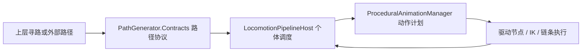

# ProceduralController：个体程序动作控制

本模块控制一个个体的躯体/头部、步态、IK、蛇身和触手，不计算路径。路径来自上层系统，经 `CelToon.PathGenerator.Contracts` 的数据协议输入；核心程序集不引用 `PathGenerator.Runtime`。

## 目录与边界

| 目录 | 职责 |
| --- | --- |
| `Contracts` | Tick、角色状态、骨架尺寸、模块计划、执行反馈及求解接口 |
| `Runtime` | 个体调度器、程序动画规划、单驱动节点执行、蛇身/触手运动、抓握观察 |
| `Execution` | 骨架绑定、校验、两段 IK 和实际末端反馈 |
| `Environment` | Unity 地面探测适配器；也可注入自定义 `IGroundProbe` |
| `Samples/Runtime` | 七形态生成器、键盘/鼠标输入、GUI；连接可选寻路实现 |
| `Samples/Editor` | 测试场景创建与保存资产验证 |
| `Samples/LocomotionIOTest.unity` | 保留原 GUID 的可操控场景 |
| `Tests/CorePlayMode` | 不引用寻路实现或 Samples 的个体控制测试 |
| `Tests/PlayMode` | 完整场景、提速、防滑及七形态回归 |



执行顺序保持 `PlanRoot → RootMotionController.Apply → PlanModules → 校验/采样 → 模块 Apply`，Body 先于腿执行。角色容器不移动，实际位置使用 `host.MotionAnchor`。步频联动、加减速、世界支撑锚点和各形态独立运动保持原行为。

## 输入方式

先用 `Configure(shape, planner, rootController, rigBinding, moduleControllers, segments, groundProbe)` 配置个体。最后一个地面接口可省略，由同对象上的 `PhysicsGroundProbe` 提供；没有探测器时使用原平地回退。

直接接收外部世界路径，不需要任何寻路组件：

```csharp
host.SetPath(new[] { host.MotionAnchor.position, corner, destination });
host.Stop(); // 按减速度停稳，已开始的脚部摆动独立完成
```

多点路径首点是路径起点；仅传一个点时，会自动补当前起点，将该点作为目的地。空数组取消路径；null、非有限数值和当前不支持的段类型会拒绝并输出无移动意图，独立动画继续执行。`SetPath` 会复制调用方数据。

接入可替换路径提供者：

```csharp
host.UseRouteProvider(provider); // IRouteProvider，可由多个个体共用
host.SetDestination(destination); // 只向提供者转发请求，不在个体内寻路
```

`SetDestination` 在没有提供者时返回 false 并报告 `host.noRouteProvider`。提交直接路径后会暂时切到直接输入；后续 `SetDestination` 可以重新启用已绑定的提供者。`UseRouteProvider(null)` 脱离提供者并减速停止。

完整 `RouteSnapshot` 可通过 `SubmitRoute` 输入，必须匹配 `host.ActorId` 和 `host.Epoch`。个体会复制、验证数据，并分配本地路径版本，避免不同提供者版本相同、点数不同导致路径进度越界。提供者更新路径时，应发布新的快照或增加 `RouteVersion`，不要原地修改已发布点数组。过期路径与错误个体身份会被停止使用，错误反馈保留。

上层统一调度可关闭自动 Update：

```csharp
host.AutoUpdate = false;
host.Tick(deltaTime, now); // deltaTime > 0，时间数值必须有限
```

自动 Update 默认开启；外部调度与自动 Update 应选择一种，保证驱动节点每帧只有一个写入流程。

## 移植

- 迁移整个板块：复制 `ProceduralController`、`PathGenerator` 两个目录及其 `.meta`。不需要旧 `Locomotion`、旧 IK/PID 脚本或原工程 GraphicsSettings。
- 只迁移个体控制核心：复制本目录的 `Contracts`、`Runtime`、`Execution`、`Environment`，以及 `PathGenerator/Contracts`；无需 `PathGenerator/Runtime`、Samples、测试或 URP。路径协议是唯一共享依赖。
- Samples 和 Tests 各有独立程序集；移植运行核心时可省略。需要完整测试集时安装 `com.unity.test-framework` 1.1.33。
- 核心依赖 UnityEngine 与内置 Physics 模块，当前验证版本 Unity 2022.3.57f1c2。保存示例场景含 URP 相机/灯光附加组件，导入该场景还需 URP 14.0.11。
- 运行时用新命名空间 `CelToon.ProceduralController.*`；路径协议用 `CelToon.PathGenerator.Contracts`。文件与目录迁移保留原 GUID，外部源码调用需更新 using 和程序集引用。

结构与独立移植验证工具：`Docs/IKRebuild/Tools/verify_modules.py`。完整运行证据见 `Docs/IKRebuild/Artifacts/`。
